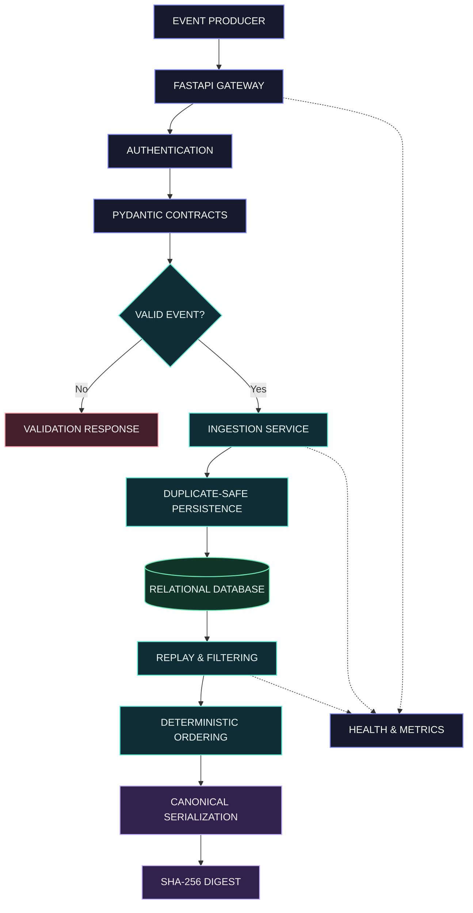

<div align="center">


<br/>

**A data engineering system built around validation, reliable persistence, and reproducible event processing.**

<br/>

[Explore Architecture](#architecture) &nbsp; · &nbsp; [API Reference](#api-reference) &nbsp; · &nbsp; [Run Locally](#run-locally) &nbsp; · &nbsp; [Connect](#connect)

<br/>

[](https://www.python.org/)
[](https://fastapi.tiangolo.com/)
[](https://www.postgresql.org/)
[](LICENSE)

</div>

---

## 01 / Project overview

MarketFlow is a Python-based market data pipeline designed to process structured events through a clearly defined ingestion and replay workflow.

Its core engineering objective is simple: **make event handling explicit, persistence dependable, and replay results reproducible.**

<details>
<summary><strong>Project at a glance</strong></summary>

| Attribute | Details |
|:--|:--|
| Domain | Data engineering and backend infrastructure |
| Runtime | Python 3.11+ |
| Interface | FastAPI |
| Validation | Pydantic |
| Persistence | SQLAlchemy with PostgreSQL |
| Quality | Pytest and Ruff |
| Deployment tooling | Docker Compose and GitHub Actions |

</details>

## 02 / Architecture

The system separates API handling, contract validation, ingestion, persistence, replay, and observability so each layer has a clear responsibility.



### Component responsibilities

| Layer | Responsibility | Engineering outcome |
|:--|:--|:--|
| API | Receive requests and apply configured authentication | Defined interface boundary |
| Validation | Enforce event schemas and input constraints | Consistent data contracts |
| Ingestion | Coordinate event processing | Separated application logic |
| Persistence | Store records with uniqueness constraints | Duplicate protection |
| Replay | Filter and order stored events | Repeatable event sequences |
| Observability | Expose health and operational metrics | Easier diagnostics |

## 03 / Core engineering

<details>
<summary><strong>01 — Contract-driven ingestion</strong></summary>

- Typed event validation with Pydantic.
- Explicit rejection of unexpected fields.
- Positive decimal values for price and quantity.
- Timestamp validation and timezone handling.
- Configurable maximum batch size.

</details>

<details>
<summary><strong>02 — Persistence integrity</strong></summary>

- Stable event identifiers.
- Database-enforced uniqueness.
- Transaction-aware persistence.
- Separation between HTTP handlers and database operations.

</details>

<details>
<summary><strong>03 — Deterministic replay</strong></summary>

- Supported event filters.
- Stable ordering by event timestamp and event identifier.
- Canonical JSON serialization.
- SHA-256 digests for comparing replay outputs.

A digest can verify equality of canonical outputs; it does not prove that the original input data is authentic.

</details>

<details>
<summary><strong>04 — Operational visibility</strong></summary>

- Service health endpoint.
- Prometheus-compatible metrics endpoint.
- Ingestion and replay instrumentation, where configured.
- Automated tests and linting.

</details>

## 04 / Event contract

| Field | Purpose | Expected constraint |
|:--|:--|:--|
| `event_id` | Identify an event | Stable identifier |
| `symbol` | Identify an instrument | Validated symbol |
| `event_time` | Record event chronology | Valid timestamp |
| `received_time` | Record arrival context | Valid timestamp when supplied |
| `price` | Represent market price | Positive decimal |
| `quantity` | Represent event quantity | Positive decimal |

The exact required fields, optional fields, timestamp rules, and batch limits are defined by the implemented schemas and configuration.

## 05 / API reference

Local base URL: `http://127.0.0.1:8000`

| Method | Endpoint | Purpose |
|:--|:--|:--|
| `GET` | `/health` | Check service health |
| `POST` | `/v1/events` | Submit event batches |
| `POST` | `/v1/replay` | Request replay results |
| `GET` | `/metrics` | Inspect operational metrics |
| `GET` | `/docs` | Explore the interactive API |

The ingestion and replay routes use the configured `X-API-Key` mechanism.

### Example ingestion request

```bash
curl -X POST "http://127.0.0.1:8000/v1/events" \
  -H "Content-Type: application/json" \
  -H "X-API-Key: YOUR_CONFIGURED_API_KEY" \
  -d '{
    "events": [
      {
        "event_id": "demo-001",
        "symbol": "NIFTY",
        "event_time": "2025-01-02T09:15:00+00:00",
        "received_time": "2025-01-02T09:15:00.010+00:00",
        "price": "23000.50",
        "quantity": "10",
        "venue": "SIM",
        "source": "manual"
      }
    ]
  }'
```

Check `schemas.py` to confirm that the example matches your actual request model before using it.

## 06 / Repository structure

```text
marketflow-data-pipeline/
├── .github/workflows/ci.yml
├── scripts/generate_sample.py
├── src/marketflow/
│   ├── api.py
│   ├── config.py
│   ├── db.py
│   ├── metrics.py
│   ├── schemas.py
│   ├── service.py
│   └── __init__.py
├── tests/
│   ├── test_api.py
│   └── test_schemas.py
├── .env.example
├── Dockerfile
├── docker-compose.yml
├── Makefile
├── pyproject.toml
├── LICENSE
└── README.md
```

## 07 / Run locally

**Requirements:** Python 3.11+, Git. Docker is optional.

**01 — Clone**

```powershell
git clone https://github.com/akankshad1712/marketflow-data-pipeline.git
cd marketflow-data-pipeline
```

**02 — Install**

```powershell
python -m venv .venv
.\.venv\Scripts\python.exe -m pip install -e ".[dev]"
Copy-Item .env.example .env
```

**03 — Configure and start**

Review `.env`, set the appropriate credentials and database configuration, then run:

```powershell
.\.venv\Scripts\python.exe -m uvicorn marketflow.api:app --reload
```

Open [API documentation](http://127.0.0.1:8000/docs).

For a configured container environment:

```bash
docker compose up --build
```

## 08 / Quality checks

```powershell
.\.venv\Scripts\python.exe -m pytest
.\.venv\Scripts\python.exe -m ruff check src tests
```

| Area | Verify |
|:--|:--|
| Contracts | Invalid payloads are rejected |
| Security | Protected endpoints reject invalid credentials |
| Persistence | Duplicate identifiers follow the defined policy |
| Replay | Filters and stable ordering behave as expected |
| Operations | Health and metrics endpoints respond correctly |

## 09 / Engineering roadmap

| Priority | Improvement | Objective |
|:--|:--|:--|
| High | Database migrations | Controlled schema evolution |
| High | Load and failure testing | Measured performance and resilience |
| Medium | Structured logs and correlation IDs | Faster diagnostics |
| Medium | Kafka or Redpanda integration | Streaming ingestion |
| Medium | OpenTelemetry | Distributed tracing |

These are planned enhancements, not claims of existing implementation.

## 10 / Connect

<div align="center">

### Akanksha Deshmukh

**Backend Engineering · Python · Data Engineering**

Interested in reliable systems, data-intensive applications, and thoughtful software architecture.

<br/>

[](https://github.com/akankshad1712)
[](https://www.linkedin.com/in/akanksha-deshmukh-26210b244/)
[](mailto:akankshadeshmukh308@gmail.com)

</div>

---

<div align="center">

<sub>MARKETFLOW — Designed for data integrity. Built for reproducibility.</sub>

</div>
