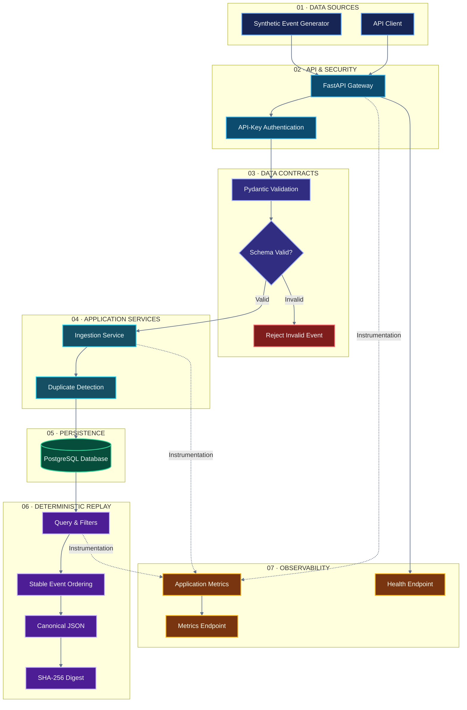
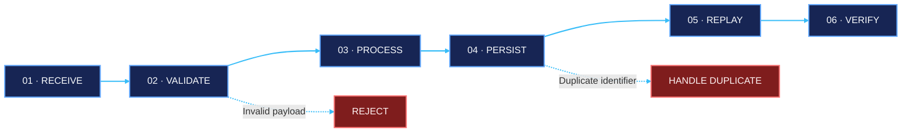
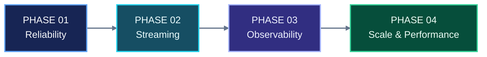

<div align="center">

# ◈ MARKETFLOW

### NEXT-GENERATION MARKET DATA INFRASTRUCTURE

**Reliable Data. Deterministic Replay. Engineering Precision.**

A modern Python-powered data engineering platform designed to validate, ingest, persist, replay, and monitor market events with consistency, integrity, and reproducibility.

<br/>

[](https://github.com/akankshad1712/marketflow-data-pipeline)
[](https://www.python.org/)
[](https://fastapi.tiangolo.com/)
[](https://www.postgresql.org/)
[](https://www.docker.com/)

<br/>

[](https://github.com/akankshad1712/marketflow-data-pipeline)
[](https://github.com/akankshad1712/marketflow-data-pipeline/issues)
[](https://www.linkedin.com/in/akanksha-deshmukh-26210b244/)
[](LICENSE)

---

**VALIDATE** &nbsp; ◆ &nbsp; **INGEST** &nbsp; ◆ &nbsp; **PERSIST** &nbsp; ◆ &nbsp; **REPLAY** &nbsp; ◆ &nbsp; **OBSERVE**

</div>

## ◈ 01 — The Vision

> **Engineering trust into every market-data event.**

Modern data infrastructure requires more than accepting incoming events. It requires explicit contracts, reliable persistence, predictable processing, duplicate protection, and reproducible outcomes.

**MarketFlow** explores these challenges through a modular data pipeline built around data integrity, deterministic replay, and operational visibility.

<table>
<tr>
<td width="50%" valign="top">

### ◉ Data Integrity

Validate incoming events and enforce clear data contracts before processing.

</td>
<td width="50%" valign="top">

### ◈ Reliable Persistence

Use stable identifiers and database constraints to protect stored records.

</td>
</tr>
<tr>
<td width="50%" valign="top">

### ⇄ Deterministic Replay

Reconstruct event sequences using consistent filtering and ordering rules.

</td>
<td width="50%" valign="top">

### ◎ Observability

Expose health information and operational metrics for better diagnostics.

</td>
</tr>
</table>

**Project scope:** MarketFlow is a portfolio engineering project using synthetic or manually supplied market events. It is not a live trading engine or an exchange-connected platform.

## ◈ 02 — Project Overview

| Attribute | Details |
|:--|:--|
| Project Name | MarketFlow — Market Data Pipeline & Replay Engine |
| Category | Backend Engineering · Data Engineering · Quantitative Infrastructure |
| Language | Python 3.11+ |
| API Framework | FastAPI |
| Data Validation | Pydantic |
| ORM | SQLAlchemy |
| Database | PostgreSQL |
| Local Database | SQLite, where supported by configuration |
| Monitoring | Prometheus-compatible metrics |
| Testing | Pytest |
| Linting | Ruff |
| Containerization | Docker · Docker Compose |
| CI Automation | GitHub Actions |
| Replay Integrity | Canonical serialization · SHA-256 |
| License | MIT |

## ◈ 03 — Premium System Architecture

MarketFlow separates request handling, data validation, application services, persistence, replay, and monitoring into distinct architectural layers.



### Architectural Responsibility Matrix

| Layer | Component | Responsibility | Benefit |
|:--|:--|:--|:--|
| Input | Event generator / API client | Supplies event payloads | Flexible event ingestion |
| API | FastAPI | Exposes HTTP endpoints | Clear service boundary |
| Security | API-key dependency | Protects configured endpoints | Controlled access |
| Validation | Pydantic | Checks event contracts | Early error detection |
| Application | Ingestion service | Coordinates processing | Separation of concerns |
| Persistence | SQLAlchemy / database | Stores event records | Durable data management |
| Replay | Replay engine | Filters and orders events | Reproducible results |
| Integrity | SHA-256 | Generates replay digests | Output comparison |
| Monitoring | Metrics and health endpoints | Exposes operational signals | Easier diagnosis |
| Quality | Pytest | Verifies expected behavior | Regression prevention |

**Design principle:** Validate at the boundary. Persist deliberately. Replay deterministically. Observe continuously.

## ◈ 04 — Event Processing Flow



| Stage | Operation | Expected Result |
|:--|:--|:--|
| 01 | Receive | Accept an incoming request |
| 02 | Validate | Reject invalid event payloads |
| 03 | Process | Apply ingestion rules |
| 04 | Persist | Store events subject to database constraints |
| 05 | Replay | Retrieve events using stable ordering |
| 06 | Verify | Compare canonical replay digests |

## ◈ 05 — Core Capabilities

### 01 / Contract-First Ingestion

- Strongly typed event schemas using Pydantic.
- Explicit handling of unexpected fields.
- Event identifier and symbol validation.
- Timezone-aware timestamp processing.
- UTC normalization where configured.
- Positive decimal validation for prices and quantities.
- Configurable batch-size limits.
- Clear validation errors.

### 02 / Duplicate-Safe Persistence

- Stable event identifiers.
- Database-level uniqueness constraints.
- Duplicate-aware ingestion behavior.
- Transaction-based persistence.
- Separation between API handlers and database operations.

### 03 / Deterministic Event Replay

- Optional symbol and time-range filtering.
- Stable ordering by event timestamp and event identifier.
- Canonical JSON serialization.
- SHA-256 digest generation.
- Configurable replay limits.

A digest helps compare serialized replay outputs. It does not independently prove source authenticity or guarantee equivalence between different datasets.

### 04 / Operational Observability

- Health endpoint.
- Accepted-event and duplicate-event counters.
- Batch-processing measurements.
- Ingestion-latency measurements.
- Replay activity metrics.
- Prometheus-compatible metrics exposure.

### 05 / Security Baseline

- API-key protection for configured endpoints.
- Constant-time credential comparison.
- Environment-based configuration.
- Non-sensitive example environment file.
- Separation between local development and deployment settings.

> **Production consideration:** A shared API key is only a baseline. Production deployments should implement TLS, managed secrets, credential rotation, least-privilege access, and appropriate network restrictions.

## ◈ 06 — API Reference

**Local base URL:** `http://127.0.0.1:8000`

| Method | Endpoint | Authentication | Purpose |
|:--|:--|:--|:--|
| `GET` | `/health` | As configured | Service health |
| `POST` | `/v1/events` | `X-API-Key` | Ingest event batches |
| `POST` | `/v1/replay` | `X-API-Key` | Retrieve replay results |
| `GET` | `/metrics` | As configured | Expose operational metrics |
| `GET` | `/docs` | As configured | Interactive API documentation |

### Example / Ingest Market Events

```bash
curl -X POST "http://127.0.0.1:8000/v1/events" \
  -H "Content-Type: application/json" \
  -H "X-API-Key: local-dev-key-change-me" \
  -d '{
    "events": [
      {
        "event_id": "demo-001",
        "symbol": "NIFTY",
        "event_time": "2025-01-02T09:15:00+00:00",
        "received_time": "2025-01-02T09:15:00.010+00:00",
        "price": "23000.50",
        "quantity": "10",
        "venue": "SIM",
        "source": "manual"
      }
    ]
  }'
```

### Example / Replay Market Events

```bash
curl -X POST "http://127.0.0.1:8000/v1/replay" \
  -H "Content-Type: application/json" \
  -H "X-API-Key: local-dev-key-change-me" \
  -d '{
    "symbol": "NIFTY",
    "limit": 1000
  }'
```

Use the API key configured in your local environment. The sample key is for illustration only.

### Developer Console

| Resource | URL |
|:--|:--|
| Swagger UI | `http://127.0.0.1:8000/docs` |
| Health Check | `http://127.0.0.1:8000/health` |
| Metrics | `http://127.0.0.1:8000/metrics` |

## ◈ 07 — Data Contract

| Field | Validation Rule | Purpose |
|:--|:--|:--|
| `event_id` | Required stable identifier | Event identity |
| `symbol` | Uppercase alphanumeric; period, underscore, and hyphen permitted | Instrument identification |
| `event_time` | Required timezone-aware timestamp | Event chronology |
| `received_time` | Optional timezone-aware timestamp | Arrival-time context |
| Timestamp ordering | Event time must not exceed receive time when both are supplied | Temporal consistency |
| `price` | Strictly positive decimal | Price validation |
| `quantity` | Strictly positive decimal | Quantity validation |
| Unknown fields | Rejected by the strict schema | Explicit schema control |
| Batch size | Controlled by `MAX_BATCH_SIZE` | Resource protection |
| Persistence uniqueness | Database-enforced event identifier | Duplicate protection |
| Replay ordering | Event timestamp and event identifier | Stable replay |

## ◈ 08 — Repository Structure

```text
marketflow-data-pipeline/
│
├── .github/
│   └── workflows/
│       └── ci.yml
│
├── scripts/
│   └── generate_sample.py
│
├── src/
│   └── marketflow/
│       ├── __init__.py
│       ├── api.py
│       ├── config.py
│       ├── db.py
│       ├── metrics.py
│       ├── schemas.py
│       └── service.py
│
├── tests/
│   ├── test_api.py
│   └── test_schemas.py
│
├── .env.example
├── .gitignore
├── Dockerfile
├── docker-compose.yml
├── LICENSE
├── Makefile
├── pyproject.toml
└── README.md
```

### Module Architecture

| File | Responsibility | Layer |
|:--|:--|:--|
| `api.py` | HTTP endpoints and authentication | Interface |
| `schemas.py` | Event contracts and validation | Validation |
| `service.py` | Ingestion and replay operations | Application |
| `db.py` | Database configuration and models | Persistence |
| `config.py` | Environment-based settings | Configuration |
| `metrics.py` | Operational instrumentation | Observability |
| `tests/` | Automated behavior checks | Quality assurance |
| `.github/workflows/` | CI automation | DevOps |

*Verify filenames against the actual repository before treating the documented tree as the implemented structure.*

## ◈ 09 — Quick Start

### Prerequisites

| Requirement | Purpose |
|:--|:--|
| Python 3.11+ | Application runtime |
| Git | Source control |
| Docker Desktop | Optional containerized environment |
| PowerShell | Windows development commands |

### Option A / Windows Development

**Step 01 — Clone the repository**

```powershell
git clone https://github.com/akankshad1712/marketflow-data-pipeline.git
cd marketflow-data-pipeline
```

**Step 02 — Create a virtual environment**

```powershell
python -m venv .venv
```

**Step 03 — Install dependencies**

```powershell
.\.venv\Scripts\python.exe -m pip install -e ".[dev]"
```

**Step 04 — Configure environment variables**

```powershell
Copy-Item .env.example .env
```

Review `.env` and configure the database and API key according to the application settings.

**Step 05 — Start the API**

```powershell
.\.venv\Scripts\python.exe -m uvicorn marketflow.api:app --reload
```

Open `http://127.0.0.1:8000/docs` in your browser.

### Option B / Docker Compose

Start the configured services:

```powershell
docker compose up --build
```

Stop the services:

```powershell
docker compose down
```

Inspect the Compose configuration and environment settings before exposing services outside your local development environment.

## ◈ 10 — Testing & Code Quality

### Run Automated Tests

```powershell
.\.venv\Scripts\python.exe -m pytest
```

### Run Ruff

```powershell
.\.venv\Scripts\python.exe -m ruff check src tests
```

### Generate Synthetic Events

```powershell
.\.venv\Scripts\python.exe scripts/generate_sample.py --count 100 --out sample_events.json
```

### Quality Verification Matrix

| Test Area | Expected Behavior |
|:--|:--|
| Schema validation | Invalid symbols, timestamps, prices, and quantities are rejected |
| Unknown fields | Unexpected fields fail validation |
| Authentication | Invalid API keys are rejected on protected endpoints |
| Idempotency | Repeated event IDs do not create duplicate persisted records |
| Batch limits | Oversized ingestion requests are rejected |
| Replay | Ordering remains stable and supported filters are applied |
| Metrics | Configured metrics are exposed |
| Failure handling | Request and persistence failures produce appropriate outcomes |

Run the checks before publishing test results. Do not claim measured performance, coverage, or reliability without evidence.

## ◈ 11 — Reliability Engineering

| Concern | Baseline Approach | Future Enhancement |
|:--|:--|:--|
| Invalid events | Schema validation and rejection | Rejected-event quarantine |
| Duplicate delivery | Stable IDs and database constraints | Explicit retry/conflict policies |
| Replay reproducibility | Stable ordering and canonical digests | Versioned replay rules |
| Oversized batches | Configurable limits | Backpressure and load testing |
| Database availability | Database-backed processing | Recovery and retry policies |
| Observability | Health and metrics endpoints | Dashboards, tracing, and alerting |
| Schema evolution | Strict validation | Versioned contracts and migrations |
| Secrets | Environment-based configuration | Managed secrets and rotation |

## ◈ 12 — Engineering Roadmap



| Priority | Enhancement | Expected Benefit |
|:--|:--|:--|
| P1 | Load and failure-injection benchmarks | Quantified throughput and recovery |
| P1 | Alembic migrations | Safer schema evolution |
| P1 | Structured logging and correlation IDs | Better diagnostics |
| P2 | Kafka or Redpanda consumers | Event-stream integration |
| P2 | Bounded retries and dead-letter handling | Improved failure isolation |
| P2 | OpenTelemetry integration | Distributed tracing |
| P2 | Property-based replay tests | Broader correctness verification |
| P3 | Partitioning and retention policies | Larger dataset support |
| P3 | Reproducible benchmark reports | Evidence-based optimization |

**Roadmap items are planned enhancements, not implemented features unless verified in the repository.**

## ◈ 13 — Performance & Benchmarking

Performance claims should be reproducible and backed by documented measurements.

| Metric | Engineering Purpose |
|:--|:--|
| Events per second | Throughput |
| p50 / p95 / p99 latency | Response-time distribution |
| CPU and memory usage | Resource efficiency |
| Validation failure rate | Data-quality assessment |
| Duplicate-event rate | Deduplication workload |
| Processing error rate | Reliability assessment |
| Database recovery time | Resilience |
| Repeated-run variance | Measurement consistency |

Document hardware, software versions, database configuration, batch sizes, payload sizes, test duration, and repeated runs.

No unverified throughput, latency, uptime, or availability figures are claimed.

## ◈ 14 — Security & Responsible Use

- Never commit `.env` files, credentials, API keys, or private datasets.
- Keep `.env.example` free of sensitive information.
- Replace development credentials before deployment.
- Use HTTPS and suitable authentication for remote environments.
- Restrict operational endpoints according to deployment requirements.
- Validate untrusted input.
- Review dependencies and container settings before release.

MarketFlow uses synthetic or manually supplied events. It does not execute trades or provide investment advice.

## ◈ 15 — About the Engineer

<div align="center">


### Akanksha Deshmukh

**Python Engineering · Data Engineering · Backend Systems · AI Engineering**

Building reliable data systems, reproducible workflows, observable APIs, and thoughtfully architected software.

<br/>

[](https://github.com/akankshad1712)
[](https://www.linkedin.com/in/akanksha-deshmukh-26210b244/)
[](mailto:akankshadeshmukh308@gmail.com)

</div>

### Professional Contact Directory

| Channel | Connect |
|:--|:--|
| Email | [akankshadeshmukh308@gmail.com](mailto:akankshadeshmukh308@gmail.com) |
| GitHub Profile | [github.com/akankshad1712](https://github.com/akankshad1712) |
| Project Repository | [MarketFlow Data Pipeline](https://github.com/akankshad1712/marketflow-data-pipeline) |
| LinkedIn | [Akanksha Deshmukh](https://www.linkedin.com/in/akanksha-deshmukh-26210b244/) |

Open to engineering discussions, constructive feedback, collaboration, and relevant professional opportunities.

## ◈ 16 — License

Distributed under the **MIT License**. See [`LICENSE`](LICENSE) for complete terms.

---

<div align="center">

### ◈ MARKETFLOW

**RELIABLE DATA IN. REPRODUCIBLE RESULTS OUT.**

<sub>Validate with precision. Persist with confidence. Replay with consistency.</sub>

<br/>

[](https://github.com/akankshad1712/marketflow-data-pipeline)

<br/>

<sub>Crafted by Akanksha Deshmukh · Python · Data Engineering · Quant Infrastructure</sub>

</div>
