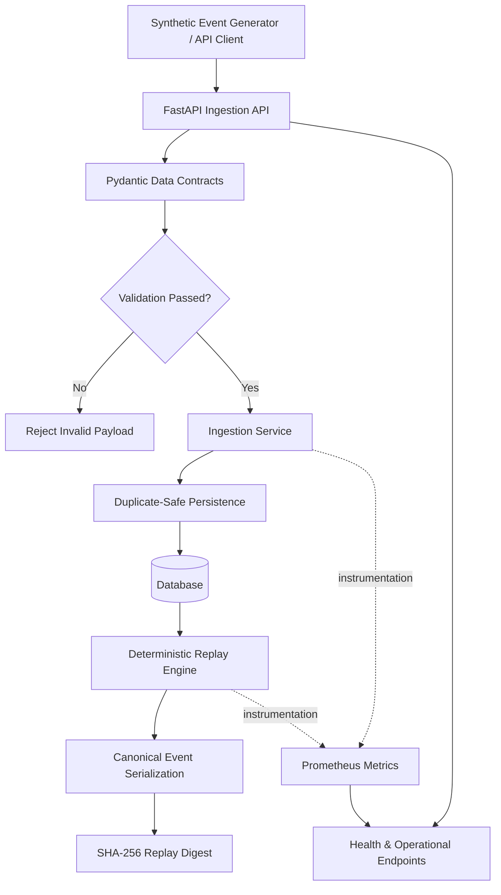

# ◈ MarketFlow
### Reliable Market Data Infrastructure · Validation · Deterministic Replay

<p align="center">
  <strong>Engineering trust into every market-data event.</strong>
</p>

<p align="center">
  A production-inspired Python data engineering platform for validating, ingesting, storing, replaying, and observing market events—with correctness and reproducibility at its core.
</p>

<p align="center">
  <a href="https://github.com/akankshad1712/marketflow-data-pipeline">
    
  </a>
  
  
  
</p>

<p align="center">
  <a href="https://github.com/akankshad1712/marketflow-data-pipeline">Repository</a>
  &nbsp;·&nbsp;
  <a href="https://github.com/akankshad1712/marketflow-data-pipeline/issues">Issues</a>
  &nbsp;·&nbsp;
  <a href="https://github.com/akankshad1712">GitHub Profile</a>
  &nbsp;·&nbsp;
  <a href="https://www.linkedin.com/in/akanksha-deshmukh-26210b244/">LinkedIn</a>
</p>

---

## 01 / The Vision

MarketFlow explores a fundamental challenge in quantitative research and data engineering:

> **How do you make data pipelines reliable enough that the same input produces the same explainable result—and failures can be investigated rather than guessed at?**

In financial data systems, malformed events, duplicate deliveries, inconsistent timestamps, and non-reproducible processing can undermine downstream analysis.

MarketFlow addresses these engineering concerns through explicit data contracts, validated ingestion, duplicate-safe persistence, deterministic event replay, operational metrics, and automated tests.

It is a portfolio project demonstrating production-oriented engineering practices—not a live trading system, broker integration, or investment product.

## 02 / At a Glance

| Dimension | Implementation |
|:--|:--|
| Project | MarketFlow — Market Data Pipeline & Replay Engine |
| Category | Backend Engineering · Data Engineering · Quant Infrastructure |
| Language | Python 3.11+ |
| API framework | FastAPI |
| Validation | Pydantic |
| Data access | SQLAlchemy |
| Database | PostgreSQL with Docker Compose; SQLite for local development |
| Observability | Prometheus-compatible metrics |
| Testing | Pytest |
| Deployment tooling | Docker and Docker Compose |
| Automation | GitHub Actions CI workflow |
| Data source | Synthetic and manually supplied market events |
| Replay strategy | Stable event ordering and SHA-256 digest |
| License | MIT |

## 03 / System Architecture

MarketFlow separates request validation, application logic, persistence, replay, and monitoring so each responsibility can be inspected and tested.



### Architectural responsibilities

| Layer | Responsibility | Engineering benefit |
|:--|:--|:--|
| API boundary | Receives ingestion and replay requests | Clear, documented service interface |
| Validation layer | Enforces event schema and field constraints | Invalid data is rejected early |
| Application service | Processes batches and coordinates persistence | Separates business logic from HTTP handlers |
| Persistence layer | Stores accepted events with uniqueness enforcement | Duplicate deliveries do not create duplicate records |
| Replay engine | Orders and serializes matching events consistently | Reproducible output for identical stored inputs |
| Digest generation | Computes a SHA-256 digest of canonicalized replay data | Supports replay comparisons and integrity checks |
| Metrics layer | Exposes counters and latency measurements | Enables operational visibility |
| Test layer | Exercises validation and API behavior | Helps detect regressions |

### Design principle

**Validate at the boundary. Persist deliberately. Replay deterministically. Observe continuously.**

## 04 / Core Capabilities

### 01 — Contract-First Data Ingestion

- Strongly typed event models using Pydantic.
- Explicit rejection of unexpected fields.
- Normalization of timezone-aware timestamps to UTC.
- Validation of symbol formats, event identifiers, positive prices, and positive quantities.
- Configurable maximum batch size.
- Clear API errors for invalid requests.

### 02 — Duplicate-Safe Persistence

- Stable event identifiers.
- Database uniqueness constraints.
- Duplicate-aware ingestion behavior.
- Transaction-based database operations.
- Persistence logic separated from request-handling code.

Idempotency is enforced at the persistence boundary, rather than relying solely on a client to avoid resending events.

### 03 — Deterministic Event Replay

- Optional symbol and time-range filtering.
- Stable ordering by event timestamp and event identifier.
- Canonical JSON serialization.
- SHA-256 digest generation for replay comparisons.
- Configurable replay limits.

The digest helps compare repeated processing of the same stored event sequence. It does not, by itself, prove that an external data source is authentic or that two different datasets are equivalent.

### 04 — Observability by Design

- Request-level health endpoint.
- Accepted-event and duplicate-event counters.
- Batch-processing metrics.
- Ingestion-latency measurements.
- Replay activity metrics.
- Prometheus-compatible metrics endpoint.

### 05 — Security Baseline

- API-key protection for ingestion and replay endpoints.
- Constant-time API-key comparison.
- Environment-based configuration.
- Example environment file for local setup.

**Production note:** A shared API key is a baseline, not a complete enterprise security architecture. Production deployments should add managed secrets, key rotation, TLS, access policies, and appropriate authentication and authorization controls.

## 05 / API Reference

Base URL for local development: `http://127.0.0.1:8000`

| Method | Endpoint | Authentication | Purpose |
|:--|:--|:--|:--|
| `GET` | `/health` | Not required | Check service health |
| `POST` | `/v1/events` | `X-API-Key` | Validate and ingest a batch of events |
| `POST` | `/v1/replay` | `X-API-Key` | Retrieve matching events in deterministic order |
| `GET` | `/metrics` | Not required in the current implementation | Expose service metrics |
| `GET` | `/docs` | Not required in local development | Explore the interactive OpenAPI documentation |

### Example ingestion request

```bash
curl -X POST "http://127.0.0.1:8000/v1/events" \
  -H "Content-Type: application/json" \
  -H "X-API-Key: local-dev-key-change-me" \
  -d '{
    "events": [
      {
        "event_id": "demo-001",
        "symbol": "NIFTY",
        "event_time": "2025-01-02T09:15:00+00:00",
        "received_time": "2025-01-02T09:15:00.010+00:00",
        "price": "23000.50",
        "quantity": "10",
        "venue": "SIM",
        "source": "manual"
      }
    ]
  }'
```

Use the configured local API key. The example key is for development only.

### Example replay request

```bash
curl -X POST "http://127.0.0.1:8000/v1/replay" \
  -H "Content-Type: application/json" \
  -H "X-API-Key: local-dev-key-change-me" \
  -d '{
    "symbol": "NIFTY",
    "limit": 1000
  }'
```

### Interactive API documentation

After starting the service, open:

- Swagger UI: `http://127.0.0.1:8000/docs`
- Health: `http://127.0.0.1:8000/health`
- Metrics: `http://127.0.0.1:8000/metrics`

## 06 / Data Contract

Every accepted event is expected to satisfy the following rules.

| Field / Rule | Contract |
|:--|:--|
| `event_id` | Required stable identifier |
| `symbol` | Uppercase alphanumeric symbol; period, underscore, and hyphen are permitted |
| `event_time` | Required timezone-aware timestamp |
| `received_time` | Optional timezone-aware timestamp |
| Timestamp ordering | Event time cannot exceed receive time when both are supplied |
| `price` | Strictly positive decimal value |
| `quantity` | Strictly positive decimal value |
| Additional fields | Rejected to make schema drift explicit |
| Batch size | Restricted by `MAX_BATCH_SIZE` |
| Persistence uniqueness | Enforced using the event identifier |
| Replay ordering | Stable event-time and event-ID ordering |

Explicit contracts help downstream consumers distinguish valid market events from malformed or inconsistent input.

## 07 / Repository Structure

```text
marketflow-data-pipeline/
│
├── .github/
│   └── workflows/
│       └── ci.yml              # Continuous integration workflow
│
├── scripts/
│   └── generate_sample.py      # Synthetic event generator
│
├── src/
│   └── marketflow/
│       ├── __init__.py
│       ├── api.py              # FastAPI routes and API-key dependency
│       ├── config.py           # Environment-based settings
│       ├── db.py               # Database setup and persistence models
│       ├── metrics.py          # Prometheus-compatible metrics
│       ├── schemas.py          # Pydantic data contracts
│       └── service.py          # Ingestion, deduplication, and replay logic
│
├── tests/
│   ├── test_api.py             # API behavior tests
│   └── test_schemas.py         # Data-contract tests
│
├── .env.example                # Example environment configuration
├── .gitignore
├── Dockerfile
├── docker-compose.yml
├── LICENSE
├── Makefile
├── pyproject.toml
└── README.md
```

## 08 / Quick Start

### Prerequisites

| Requirement | Purpose |
|:--|:--|
| Python 3.11 or newer | Application runtime |
| Git | Version control |
| Docker Desktop | Optional containerized PostgreSQL setup |
| PowerShell or terminal | Run setup commands |

### Option A — Local development on Windows

Clone the repository:

```powershell
git clone https://github.com/akankshad1712/marketflow-data-pipeline.git
cd marketflow-data-pipeline
```

Create a virtual environment:

```powershell
python -m venv .venv
```

Install the project and development dependencies:

```powershell
.\.venv\Scripts\python.exe -m pip install -e ".[dev]"
```

Create a local environment file:

```powershell
Copy-Item .env.example .env
```

Review `.env` and configure a local development API key and database settings as needed.

Start the API:

```powershell
.\.venv\Scripts\python.exe -m uvicorn marketflow.api:app --reload
```

Open `http://127.0.0.1:8000/docs` to explore the API.

### Option B — Docker Compose

With Docker Desktop running:

```powershell
docker compose up --build
```

This starts the configured application and PostgreSQL services.

Stop the services with:

```powershell
docker compose down
```

Inspect the Compose configuration and environment settings before exposing the service beyond your local machine.

## 09 / Testing & Quality

Run the automated tests:

```powershell
.\.venv\Scripts\python.exe -m pytest
```

Run the linter:

```powershell
.\.venv\Scripts\python.exe -m ruff check src tests
```

Generate synthetic events:

```powershell
.\.venv\Scripts\python.exe scripts/generate_sample.py --count 100 --out sample_events.json
```

### What to verify

| Test area | Expected behavior |
|:--|:--|
| Schema validation | Invalid symbols, timestamps, prices, or quantities are rejected |
| Unknown fields | Unexpected fields fail validation |
| Authentication | Missing or invalid API keys are rejected for protected routes |
| Idempotency | Repeated event identifiers do not produce duplicate persisted records |
| Batch limits | Oversized ingestion requests are rejected |
| Replay | Event ordering is stable and filters are applied |
| Metrics | Operational metrics are exposed at `/metrics` |

Test coverage and test results should be verified in the current environment. No throughput, latency percentile, or availability claim is published here without a measured benchmark.

## 10 / Reliability & Failure Semantics

Reliable pipelines need explicit behavior under imperfect conditions.

| Concern | Current approach | Further production work |
|:--|:--|:--|
| Invalid events | Contract validation and rejection | Optional quarantine store for rejected payloads |
| Duplicate delivery | Unique event identifier and database constraint | Document retry semantics and conflict handling |
| Replay reproducibility | Stable ordering and canonical digest | Version replay rules and test cross-version compatibility |
| Oversized batches | Configurable size limit | Load testing and backpressure policies |
| Database availability | Database-backed processing | Retry strategy, connection management, and recovery tests |
| Observability | Counters and latency metrics | Dashboards, alert rules, tracing, and SLOs |
| Schema evolution | Strict validation | Versioned schemas and database migrations |
| Secrets | Environment-based configuration | Managed secrets and rotation |

These are engineering boundaries, not claims that every production capability is already implemented.

## 11 / Engineering Roadmap

The next stages focus on moving from a reliable portfolio service toward a more complete quantitative data platform.

| Priority | Planned enhancement | Why it matters |
|:--|:--|:--|
| P1 | Load and failure-injection benchmarks | Establish measured throughput and recovery behavior |
| P1 | Database migrations with Alembic | Manage schema evolution safely |
| P1 | Structured logging and request correlation IDs | Improve debugging and incident investigation |
| P2 | Kafka or Redpanda ingestion consumer | Introduce event streaming and consumer recovery |
| P2 | Bounded retries and dead-letter handling | Handle transient failures and malformed source messages |
| P2 | OpenTelemetry traces and Prometheus alert rules | Improve end-to-end observability |
| P2 | Property-based and replay consistency tests | Expand validation of edge cases |
| P3 | Partitioning and retention policies | Prepare for larger time-series datasets |
| P3 | Reproducible benchmark reports | Compare throughput and latency under documented conditions |

**Scope clarity:** Kafka/Redpanda ingestion, distributed compute, and production-scale benchmarks are roadmap items, not features claimed as implemented in the current repository.

## 12 / Performance & Benchmarking Philosophy

Performance numbers are useful only when they can be reproduced.

Before publishing benchmark results, record:

- CPU, memory, operating system, and database configuration.
- Event count, batch size, and event payload size.
- Test duration and number of repeated runs.
- Events processed per second.
- p50, p95, and p99 latency.
- Validation failures, duplicates, and processing errors.
- Behavior during database interruption and service recovery.
- Whether results were measured locally, in Docker, or in a deployed environment.

A target such as 99.9% successful processing is a goal to test—not a measured result until supported by evidence.

## 13 / Security & Responsible Use

- Never commit `.env` files, real credentials, API keys, or private datasets.
- Use `.env.example` only for non-sensitive configuration templates.
- Replace development credentials before deployment.
- Use HTTPS and appropriate access controls for remote deployments.
- Restrict metrics and operational endpoints according to deployment requirements.
- Validate untrusted input and monitor unexpected request patterns.

MarketFlow uses synthetic or manually supplied events. It does not connect to a live exchange, execute trades, or provide investment advice.

## 14 / About the Author

<p align="center">
  <strong>Akanksha Deshmukh</strong><br/>
  Python · Data Engineering · Backend Systems · AI Engineering
</p>

<p align="center">
  Interested in building reliable data systems, reproducible workflows, observable APIs, and production-oriented software.
</p>

<p align="center">
  <a href="https://github.com/akankshad1712">
    
  </a>
  <a href="https://www.linkedin.com/in/akanksha-deshmukh-26210b244/">
    
  </a>
</p>

<p align="center">
  <a href="mailto:akankshadeshmukh308@gmail.com">akankshadeshmukh308@gmail.com</a>
</p>

## 15 / Connect & Collaborate

For engineering discussions, project feedback, and relevant opportunities:

- **Email:** [akankshadeshmukh308@gmail.com](mailto:akankshadeshmukh308@gmail.com)
- **GitHub:** [github.com/akankshad1712](https://github.com/akankshad1712)
- **LinkedIn:** [Akanksha Deshmukh](https://www.linkedin.com/in/akanksha-deshmukh-26210b244/)

## License

Distributed under the MIT License. See [`LICENSE`](LICENSE) for details.

---

<p align="center">
  <strong>MarketFlow</strong><br/>
  <sub>Reliable data in. Reproducible results out.</sub>
</p>

<p align="center">
  <sub>Built with a focus on correctness, clarity, and engineering discipline.</sub>
</p>
