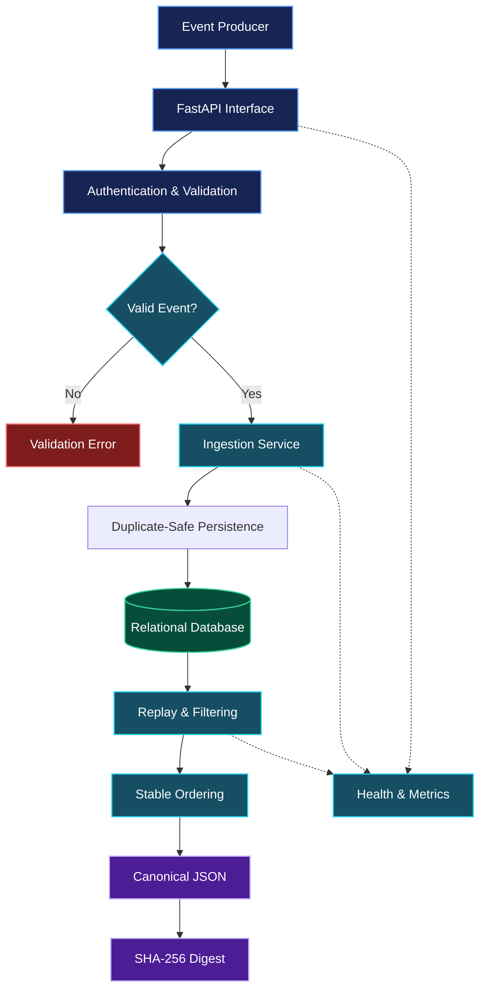

<div align="center">

# MARKETFLOW
### Market Data Infrastructure · Built for Reliability

**A Python engineering project focused on validated event ingestion, reliable persistence, and deterministic replay.**

[Architecture](#architecture) · [Engineering](#engineering-design) · [API](#api-contract) · [Setup](#run-locally) · [Contact](#connect)

<br/>

[](https://www.python.org/)
[](https://fastapi.tiangolo.com/)
[](https://www.sqlalchemy.org/)
[](https://www.docker.com/)
[](LICENSE)

</div>

---

## The engineering idea

Market data is useful only when its structure, storage, and processing can be trusted.

**MarketFlow** explores the engineering foundations behind dependable data pipelines: validating events at the boundary, persisting records with duplicate protection, reconstructing event sequences consistently, and exposing operational signals for diagnosis.

Rather than treating ingestion as a single API operation, the project separates responsibilities into independently understandable layers.

| Engineering challenge | Design response |
|:--|:--|
| Inconsistent input | Explicit, typed validation contracts |
| Repeated event delivery | Stable identifiers and database uniqueness constraints |
| Unpredictable replay order | Timestamp-based ordering with an identifier tie-breaker |
| Difficult result comparison | Canonical serialization and SHA-256 digests |
| Limited operational visibility | Health checks and metrics endpoints |

> **Project scope:** MarketFlow processes synthetic or manually supplied market events. It is an engineering demonstration, not a live exchange feed, trading system, or investment product.

## Architecture



### Component boundaries

| Component | Responsibility |
|:--|:--|
| API interface | Receives requests and enforces configured authentication |
| Schema layer | Defines event contracts and rejects invalid payloads |
| Ingestion service | Coordinates processing and persistence |
| Database layer | Manages records and uniqueness constraints |
| Replay service | Applies supported filters and deterministic ordering |
| Observability layer | Exposes service health and operational measurements |

## Engineering design

### Data contract

The event model defines the information required to identify, validate, and replay a market event.

| Field | Meaning |
|:--|:--|
| `event_id` | Stable event identifier |
| `symbol` | Instrument or market symbol |
| `event_time` | Timestamp associated with the event |
| `received_time` | Timestamp recording when the event was received |
| `price` | Positive decimal price |
| `quantity` | Positive decimal quantity |

Validation rules, timestamp requirements, unknown-field handling, and maximum batch size are governed by the application's schema and configuration.

### Deterministic replay

Replay should produce a predictable sequence for the same stored dataset and replay parameters.

1. Retrieve events matching the supported filters.
2. Apply a stable sort using event timestamp and event identifier.
3. Serialize the resulting data into a canonical representation.
4. Calculate a SHA-256 digest for comparison.

A matching digest can help establish that two canonical outputs are identical. It is not, by itself, proof of authenticity or correctness of the original source data.

### Reliability decisions

- **Explicit contracts:** Reject malformed events before application processing.
- **Database constraints:** Enforce uniqueness at the persistence boundary.
- **Bounded ingestion:** Apply configured limits to control request size.
- **Separated responsibilities:** Keep HTTP handling distinct from business logic.
- **Observable behavior:** Expose health and metrics for operational diagnosis.

## API contract

Local development base URL: `http://127.0.0.1:8000`

| Method | Route | Purpose |
|:--|:--|:--|
| `GET` | `/health` | Inspect service health |
| `POST` | `/v1/events` | Submit event batches |
| `POST` | `/v1/replay` | Request replay results |
| `GET` | `/metrics` | Inspect exported metrics |
| `GET` | `/docs` | Explore the interactive API schema |

The ingestion and replay endpoints use the configured `X-API-Key` authentication mechanism.

### Example request

```bash
curl -X POST "http://127.0.0.1:8000/v1/events" \
  -H "Content-Type: application/json" \
  -H "X-API-Key: YOUR_CONFIGURED_API_KEY" \
  -d '{
    "events": [
      {
        "event_id": "demo-001",
        "symbol": "NIFTY",
        "event_time": "2025-01-02T09:15:00+00:00",
        "received_time": "2025-01-02T09:15:00.010+00:00",
        "price": "23000.50",
        "quantity": "10",
        "venue": "SIM",
        "source": "manual"
      }
    ]
  }'
```

The payload illustrates the intended event shape. Confirm optional fields and exact request models against `schemas.py` before using it with the running application.

## Technology choices

| Technology | Role in the project |
|:--|:--|
| Python | Application logic and data processing |
| FastAPI | HTTP interface and API documentation |
| Pydantic | Structured validation |
| SQLAlchemy | Database access and persistence abstractions |
| PostgreSQL | Relational storage |
| SQLite | Local development option where supported |
| Pytest | Automated testing |
| Ruff | Static linting and code-quality checks |
| Docker Compose | Local multi-service orchestration |
| GitHub Actions | Continuous integration workflow |
| Prometheus-compatible metrics | Operational observability |

## Repository map

```text
marketflow-data-pipeline/
├── .github/
│   └── workflows/
│       └── ci.yml
├── scripts/
│   └── generate_sample.py
├── src/
│   └── marketflow/
│       ├── __init__.py
│       ├── api.py
│       ├── config.py
│       ├── db.py
│       ├── metrics.py
│       ├── schemas.py
│       └── service.py
├── tests/
│   ├── test_api.py
│   └── test_schemas.py
├── .env.example
├── Dockerfile
├── docker-compose.yml
├── Makefile
├── pyproject.toml
├── LICENSE
└── README.md
```

## Run locally

**Requirements:** Python 3.11 or newer and Git. Docker is optional.

### 1. Get the source

```powershell
git clone https://github.com/akankshad1712/marketflow-data-pipeline.git
cd marketflow-data-pipeline
```

### 2. Prepare the environment

```powershell
python -m venv .venv
.\.venv\Scripts\python.exe -m pip install -e ".[dev]"
Copy-Item .env.example .env
```

Review the environment configuration and replace any development credentials.

### 3. Start the service

```powershell
.\.venv\Scripts\python.exe -m uvicorn marketflow.api:app --reload
```

Open the interactive documentation at [localhost:8000/docs](http://127.0.0.1:8000/docs).

### Alternative: Docker

```bash
docker compose up --build
```

Stop the services with `docker compose down`.

## Verification

Run the automated checks from the project root:

```powershell
.\.venv\Scripts\python.exe -m pytest
.\.venv\Scripts\python.exe -m ruff check src tests
```

| Verification area | What to examine |
|:--|:--|
| Validation | Invalid values and unexpected fields |
| Authentication | Missing or incorrect credentials |
| Persistence | Unique event identifiers and transaction behavior |
| Replay | Filtering and repeatable ordering |
| Boundaries | Batch limits and malformed requests |
| Operations | Health responses and metrics exposure |

Only report passing tests, measured performance, or coverage figures after verifying the actual results.

## Next engineering milestones

| Priority | Planned improvement | Engineering value |
|:--|:--|:--|
| High | Database migrations | Controlled schema evolution |
| High | Failure-injection and load tests | Evidence-based reliability assessment |
| Medium | Structured logs and correlation IDs | Better incident diagnosis |
| Medium | Kafka or Redpanda integration | Streaming ingestion |
| Medium | OpenTelemetry tracing | End-to-end visibility |
| Future | Partitioning and retention strategies | Larger data volumes |

These are potential extensions, not claims that the capabilities are already implemented.

## Security considerations

- Keep secrets out of version control.
- Use environment-specific credentials and rotate them when necessary.
- Apply TLS and appropriate access controls to deployed services.
- Limit access to operational endpoints.
- Review database permissions and dependency updates.
- Treat external event payloads as untrusted input.

## Connect

<div align="center">

### Akanksha Deshmukh

**Python Engineering · Backend Systems · Data Engineering**

Interested in building reliable software, data-intensive services, and maintainable engineering systems.

[](https://github.com/akankshad1712)
[](https://www.linkedin.com/in/akanksha-deshmukh-26210b244/)
[](mailto:akankshadeshmukh308@gmail.com)

</div>

## License

This project is distributed under the MIT License. See [`LICENSE`](LICENSE) for details.

---

<div align="center">

**MARKETFLOW / ENGINEERED FOR CONSISTENCY**

<sub>Clear contracts. Reliable persistence. Reproducible data.</sub>

</div>
